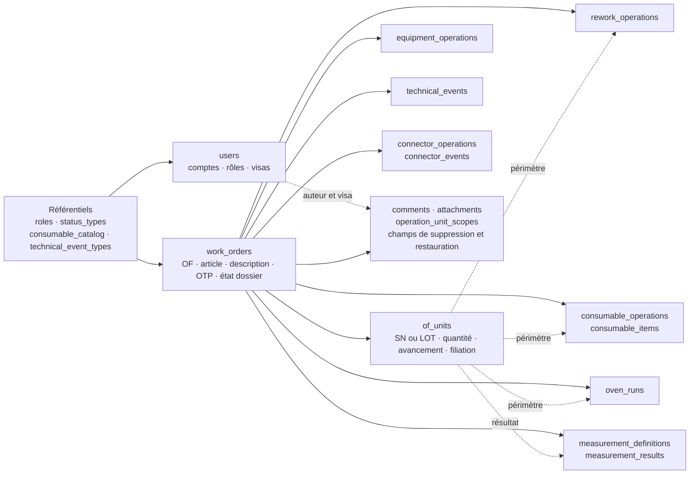

# SP-F001A7 Suivi de production

## Documentation fonctionnelle et technique

**Version documentée :** v360
**Date :** 24 novembre 2026
**Public visé :** responsables d'atelier, méthodes, qualité, logistique et IT

## 1. Objet du document

SP-F001A7 est une application interne de suivi de production par ordre de fabrication (OF) et par numéro de série ou lot. Elle centralise les opérations réalisées, les consommables, les étuvages, les équipements de test, les événements de mating/demating, les faits techniques et les mesures. Elle produit également les rapports, étiquettes, exports et messages standardisés nécessaires aux échanges entre la production, la qualité et la logistique.

SP-F001A7 est le nom provisoire de l'application. Toute autre proposition de nom est bienvenue.

Ce document présente ce qui est déjà disponible dans le pilote, les règles de traçabilité et de protection des données, les conditions de maintenance et les sujets qui restent volontairement en réflexion. Il doit permettre à un autre responsable d'atelier d'évaluer si le principe est utile pour son activité, sans considérer les pistes futures comme des fonctions déjà validées.

## 2. État actuel du pilote

Le pilote est utilisé sur le réseau interne depuis un poste Windows. L'application est servie par une API Python et utilise PostgreSQL comme source de vérité. Le serveur redémarre automatiquement au démarrage de Windows, sans ouverture de session utilisateur. Le raccourci de statut du bureau permet également d'ouvrir l'application ou de redémarrer uniquement le serveur web après confirmation, sans arrêter PostgreSQL. Les déploiements sont bloqués si les tests échouent et chaque version remplace la précédente après création d'une sauvegarde du paquet de production.

La solution est fonctionnelle pour un usage atelier, mais l'hébergement reste provisoire. Une mise en ligne institutionnelle devra transférer l'application, PostgreSQL, les sauvegardes et la supervision vers une infrastructure administrée par l'IT, avec une adresse pérenne et HTTPS.

Une instance pilote isolée est disponible sur le port 5182 avec sa propre base PostgreSQL. Elle contient une copie ponctuelle des données destinée aux essais, utilise une session distincte et affiche en permanence un bandeau rouge « BASE TEST » en haut de l'écran. La production du port 5181 affiche un bandeau bleu « BASE PRODUCTION ». Les modifications réalisées dans le pilote n'affectent pas la production et ne sont pas resynchronisées vers elle.

## 3. Principes d'utilisation

- Un dossier représente un OF.
- Un OF contient un ou plusieurs SN ou lots.
- Les informations communes restent attachées à l'OF; les opérations terrain sont rattachées au SN ou au lot concerné.
- Une consultation d'un OF ne rend pas automatiquement l'utilisateur « impliqué » dans cet OF. L'implication est déduite des opérations réellement enregistrées.
- Les lignes validées conservent le visa et la date de l'auteur.
- Les annulations, suppressions et corrections restent traçables. Les Admin et Manager disposent d'outils supplémentaires encadrés.
- Les actions principales restent visibles à droite de chaque ligne : valider ou modifier, consulter l'historique et annuler ou supprimer. Le nombre de modifications est affiché comme une notification sur l'historique.
- Les actions secondaires restent accessibles par clic droit afin de garder les tableaux lisibles sans masquer les commandes essentielles; les commentaires de chaque ligne restent accessibles à la fois par la bulle et par ce menu dans tous les onglets métier.
- La duplication utilise deux étapes : paramétrage puis vérification obligatoire. Avant confirmation, l'interface récapitule les lignes sources, la règle de copie, chaque destination et le nombre exact de lignes qui seront créées. Aucune ligne existante n'est remplacée.
- L'avancement opérationnel appartient au SN ou au lot. L'OF conserve séparément un état administratif limité à `Actif`, `À clôturer` ou `Clôturé`; le résumé global est calculé depuis ses SN et lots afin d'éviter une double saisie contradictoire.

## 4. Profils et droits

### 4.1 Utilisateurs

Chaque utilisateur possède un trigramme, un nom, un prénom, un rôle, une adresse email éventuelle et un état actif ou inactif. La désactivation d'un compte empêche une nouvelle connexion sans supprimer les opérations historiques de cet utilisateur.

### 4.2 Rôles

- **Opérateur :** saisie et validation des opérations autorisées.
- **Contrôleur :** saisie des contrôles et validation des champs de contrôle selon le processus.
- **Manager :** droits métier étendus, correction contrôlée des visas et dates, gestion de certains référentiels et utilisateurs.
- **Admin :** administration complète, paramètres et mode God pour les opérations exceptionnelles. Lorsque ce mode est actif, toute l'interface prend une teinte rouge clair, un contour rouge et un indicateur permanent « GOD MODE ACTIF » afin d'éviter toute confusion avec l'utilisation normale.
- **Lecture seule :** consultation sans écriture.

Les autorisations sont contrôlées par le serveur. Le fait de masquer un bouton dans l'interface n'est pas considéré comme une protection suffisante.

### 4.3 Authentification

Les mots de passe sont hachés avec PBKDF2-HMAC-SHA256, un sel aléatoire et 240 000 itérations. Ils ne sont jamais renvoyés au navigateur. Les sessions utilisent un cookie HttpOnly et expirent après 15 minutes d'inactivité. Un mot de passe temporaire doit être remplacé lors de la première connexion ou après une réinitialisation.

## 5. Écran d'accueil

L'accueil donne une vue opérationnelle des OF et sert de point de départ aux actions multi-OF ou multi-SN.

### 5.1 Recherche et filtres

- Recherche globale sur les informations principales, y compris OF, article, description, SN, lot, OTP et personnes ayant réellement travaillé sur l'OF.
- Filtres par colonne avec jokers : `R*` commence par R, `*R` finit par R, `*R4B*` contient R4B et `R4*-S*` combine plusieurs motifs.
- Vues « Tous », « Mes OF » et « À surveiller ».
- Masquage des dossiers clôturés pour limiter le bruit sans faire disparaître un OF encore actif dont certains SN sont terminés.
- Mode Confort ou Compact selon la taille de l'écran.

### 5.2 Suivi du jour

- Polymérisations en cours avec prochaine heure de disponibilité.
- Étuvages à faire ce soir, regroupés par OF et SN/lot.
- Anticipation au vendredi soir lorsqu'une échéance tombe pendant le week-end.
- Mise en évidence des étuvages en retard uniquement lorsqu'un premier étuvage existe déjà.
- Alerte dans le dossier concerné et accès direct à l'onglet Étuvages.

### 5.3 Environnement des salles

- Bandeau climatique commun à l'accueil et aux dossiers, avec semaine, date et heure mises en évidence au centre.
- Lecture en temps réel de la page AC2M référencée par la page réseau historique fournie par l'atelier.
- Affichage permanent limité à `#512 Salle blanche`.
- État climatique cliquable à gauche : il ouvre les détails de `#512a SAS` et `#510 Stock MA12` sans agrandir le bandeau principal.
- Température, humidité relative et pression affichées séparément pour chaque lieu; lorsqu'un seuil est dépassé, seule la mesure concernée passe en rouge.
- État climatique lisible (`Conditions conformes`, `Alarme climatique`, valeur hors limites ou données indisponibles).
- Heure de la dernière actualisation affichée à côté de l'état pour confirmer visuellement la fraîcheur des données.
- Conservation temporaire de la dernière lecture en cas d'indisponibilité brève; l'interface indique alors clairement que les données sont anciennes ou indisponibles.
- Intégration en lecture seule : SP-F001A7 ne modifie ni les mesures, ni les seuils, ni l'état de l'installation climatique.

### 5.4 Actions depuis l'accueil

- Création compacte d'un dossier sans choix mono ou multi : une première ligne SN ou lot est proposée, puis autant de SN ou de lots que nécessaire peuvent être ajoutés. Chaque lot possède sa propre quantité.
- Ouverture d'un dossier au bon SN ou lot.
- Sélection de plusieurs lignes.
- Copie au presse-papiers sous forme de vrais tableaux adaptés aux SN, lots ou sélections mixtes.
- Génération groupée de rapports, d'exports Excel SAP et d'étiquettes.
- Modification groupée de l'avancement des SN ou lots sélectionnés.
- Menus au clic droit pour changer l'avancement d'une ligne ou de tout l'OF replié, puis faire passer un dossier prêt à clôturer vers son état administratif suivant.

## 6. Dossier OF et navigation SN ou lot

L'en-tête du dossier affiche l'OF, l'article SAP, la description, le SN ou lot, l'OTP, le caractère de reprise et l'état administratif du dossier. Les flèches précédent/suivant et les touches `Ctrl+Flèche gauche` ou `Ctrl+Flèche droite` permettent de changer rapidement de SN. Les flèches sont masquées lorsqu'il n'existe qu'un seul SN ou lot.

L'avancement du SN ou lot affiché est modifiable directement à côté du sélecteur. En vue globale, un résumé présente le nombre de pièces dans chaque état et ouvre le tableau des pièces; une commande permet également d'appliquer un avancement à tous les SN et lots de l'OF. Lorsque toutes les pièces sont dans un état final, l'interface affiche `Prêt à clôturer`, mais ne clôture jamais automatiquement le dossier. La clôture administrative reste une action volontaire d'un Admin ou Manager.

Les commentaires peuvent être rattachés aux lignes métier et au SN ou lot concerné. Les liens profonds conservent l'OF, le SN ou lot et l'onglet à ouvrir. Le chemin du dossier photos de l'OF peut être copié pour être ouvert dans l'Explorateur Windows ou ajouté aux messages.

## 7. Fonctions par onglet

### 7.1 Adjust Rework

- Enregistrement des opérations soudé, dessoudé, pointé, matière, rework et observation.
- Référence topologique, article SAP, valeur ou description, lot, date code, SN composant, fiche suiveuse, étape ou OP, visas et contrôles.
- Distinction entre ligne en préparation et ligne validée.
- Bouton visible en fin de ligne pour valider une nouvelle opération puis modifier une opération existante.
- Bouton d'annulation ou de suppression maintenu visible; lors d'une modification en cours, il abandonne les changements sans effacer la ligne existante.
- Historique accessible depuis la ligne avec une notification indiquant le nombre de modifications enregistrées.
- Import d'un plan de travail depuis le presse-papiers sous forme de brouillon.
- Attribution de la ligne importée à l'opérateur qui la complète et la valide.
- Remarques importées placées dans la bulle de commentaires plutôt que dans une ligne métier artificielle.
- Lignes Observation toujours visibles.
- Duplication d'une ou plusieurs lignes dans le même SN, vers plusieurs SN ou vers un autre OF, avec choix explicite entre la même opération déjà réalisée et une nouvelle opération créée depuis la source.
- Détection des composants dessoudés sans opération ultérieure et des contrôles manquants.
- Détection des changements de valeur. Une référence ISS, DM ou NC peut justifier une valeur différente; une référence DOC exige normalement la même valeur sauf cas ADJ.
- Proposition des faits techniques déjà présents sur le SN.
- Sélection de composants pour produire une demande matière standardisée à la logistique.
- Étiquette composant et historique disponibles par clic droit.

### 7.2 Consommables

- Catalogue administrable avec article SAP, désignation, catégorie et durée de polymérisation éventuelle.
- Enregistrement par SN ou lot avec fiche suiveuse, OP, lot consommable, date de péremption, numéro d'échantillon, quantité et traçabilité.
- Quantité par défaut de 1 pour les consommables.
- Alerte visuelle « bientôt périmé » calculée au moment de l'utilisation. Cette information reste une aide dans l'interface et n'est pas transformée en non-conformité dans le PDF.
- Calcul du temps de polymérisation ou de séchage pour les produits configurés, avec la date la plus éloignée retenue lorsque plusieurs produits s'appliquent.
- Regroupement CO02 par article et lot dans un même OF avec addition des quantités.

### 7.3 Étuvages

- Enregistrement de l'entrée, de la sortie et du four utilisé.
- Cycle de suivi basé sur 72 heures depuis le dernier étuvage pertinent.
- Affichage du prochain étuvage prévu plutôt que d'une formulation ambiguë « en retard » dans le rapport PDF.
- Fermeture automatique d'une sortie oubliée en N/A lorsqu'un nouvel étuvage est lancé.
- Opération « Sortie vide » possible sans four; elle réinitialise le cycle comme un étuvage normal.
- Gestion des échéances du week-end par anticipation au vendredi soir.
- Possibilité d'écarter du suivi les sous-ensembles qui ne sont plus physiquement suivis dans cet OF, selon leur statut opérationnel.

### 7.4 Test Équipement

- Enregistrement de l'inventaire, du type, de la désignation, du four éventuel, de la date de calibration et du contrôle.
- Une calibration `N/A` est acceptée pour les appareils de production non soumis à calibration.
- Les dates dépassées sont mises en évidence dans l'interface et en rouge dans le rapport.
- Les contrôles serveur empêchent les écritures non autorisées.

### 7.5 Mating Demating

- Définition des connecteurs et suivi des cycles de mating/demating.
- Nom du connecteur présent dans les tableaux et les rapports.
- Historique daté avec visa et nombre de cycles.
- Actions opérationnelles visibles; annulation d'un événement accessible par clic droit.

### 7.6 Suivi technique

- Enregistrement des faits, NC, ISS, DM, OW et autres références techniques.
- Statut ouvert ou clôturé, dates, visas et commentaires.
- Résumé dans l'accueil et sur la page de garde des rapports.
- Étiquettes de suivi ne reprenant que le numéro du fait dans le texte principal.

### 7.7 Mesures

- Plan de mesures commun à l'OF avec fiche suiveuse, étape ou OP, libellé, unité, minimum et maximum attendus.
- Grille type Excel : SN ou lots en lignes, mesures en colonnes et navigation au clavier avec Tab.
- Même présentation pour un SN unique ou plusieurs SN.
- Valeurs numériques ou résultat textuel tel que « pas de signal », qui compte comme une mesure effectuée.
- Statut conforme, non conforme, informatif ou à mesurer avec code couleur.
- Modification volontaire d'une mesure existante, commentaires et historique.
- Annulation et suppression définitive réservée au mode God selon les droits.
- Statistiques par OF : minimum, moyenne arrondie à deux décimales et maximum, avec identification des SN concernés.
- Export Excel reprenant la même logique de grille.
- Rapport PDF complet des mesures.

Cette fonction est disponible dans le pilote, mais ses règles métier ne sont pas encore considérées comme définitives. La robustesse attendue doit être précisée avec les responsables : types de valeurs autorisés, unités, tolérances, répétitions, instruments, arrondis, gestion des valeurs impossibles, validation et verrouillage après contrôle.

## 8. Rapports, exports et communications

### 8.1 Rapports PDF

- Rapport complet ou sélection d'onglets.
- Sélection d'un ou plusieurs SN ou lots.
- Page de garde complète uniquement lorsqu'une alerte importante est présente dans le périmètre sélectionné.
- Lorsqu'il n'existe que des points ouverts non bloquants, résumé compact au début du premier rapport; lorsqu'il n'y a rien à signaler, aucune page ni zone de synthèse n'est ajoutée.
- En-tête cohérent : OTP, OF, article, description, SN ou lot et quantité si pertinente.
- Police agrandie dans les en-têtes et les tableaux pour rester lisible en A4 paysage.
- Colonnes d'audit regroupées sur les rapports larges afin de laisser davantage de place aux données métier.
- Remarques présentées comme des sous-lignes structurées avec le repère topologique, le visa, la date et le texte, puis conservées avec leur ligne source lorsque la pagination le permet.
- Mise en évidence des N/A utiles sans les présenter automatiquement comme des erreurs.
- Rapport Mesures dédié avec résultats et statistiques de l'OF.

### 8.2 Étiquettes

- Kitting.
- Log fab, avec SN mis en avant.
- Mise en stock.
- Collage ou coating avec produit, début et fin de polymérisation.
- Information de suivi technique.
- Composants dessoudés.
- Variantes portrait et paysage.
- Génération d'un lot contenant plusieurs types d'étiquettes.
- Types indisponibles grisés; aucune étiquette vide n'est produite pour un SN non éligible.

### 8.3 Excel et presse-papiers

- Export SAP IB52 et CO02.
- Première colonne « Valeur - description » pour une lecture humaine.
- Les numéros d'échantillon de consommables ne sont pas placés dans le champ SN IB52.
- Regroupement CO02 des mêmes articles et lots avec somme des quantités.
- Export Mesures sous forme de grille.
- Copie au presse-papiers avec colonnes OF, article, description, SN ou lot, quantité si lot et OTP.

### 8.4 Messages standardisés

- Demande matière à la logistique.
- Invitation Outlook pour IP avec lieu, participants requis et facultatifs, opérateurs impliqués et lien vers le dossier photos.
- Mention de transmission ultérieure de l'As-Built lorsqu'il n'est pas joint.
- Mention que l'horaire peut être décalé selon la disponibilité PA.
- Préparation de messages de clôture d'OF selon le même principe de standardisation.

## 9. Traçabilité et intégrité des données

### 9.1 Historique métier

- Visa et date de création conservés sur les lignes validées.
- Corrections de visa ou de date réservées aux Admin et Manager, avec ancien contenu, nouveau contenu, auteur, motif et date de correction.
- Une correction de date peut conserver le visa existant.
- Suppression logique privilégiée pour conserver les traces.
- Motif de suppression demandé selon le rôle et le contexte; le mode God couvre les interventions exceptionnelles.
- Le mode God est volontairement très visible sur tout l'écran et autorise les suppressions définitives prévues pour les interventions d'administration exceptionnelles.
- Comptes désactivés conservés afin que leurs activités historiques restent attribuées.

### 9.2 Écritures atomiques PostgreSQL

Chaque dossier possède une révision. Le navigateur transmet la révision qu'il a lue et le serveur refuse une écriture devenue obsolète avec une réponse HTTP 409. L'utilisateur peut alors recharger ou réessayer au lieu d'écraser silencieusement le travail d'un collègue.

PostgreSQL conserve une représentation JSONB exhaustive du dossier et des tables relationnelles pour l'exploitation et le reporting. Les deux représentations sont mises à jour dans la même transaction. Si une projection relationnelle, une contrainte ou une écriture échoue, la transaction entière est annulée : le dossier ne doit pas rester à moitié enregistré.

Les clés étrangères, contrôles de rôle, validations de structure et règles d'audit sont appliqués côté serveur. Une future maintenance ne doit pas contourner l'API par des modifications manuelles directes en base, sauf procédure IT contrôlée, sauvegardée et testée.

### 9.3 Mesures de protection contre la corruption

- Transactions PostgreSQL pour chaque modification cohérente.
- Contrôle de révision contre les écrasements concurrents.
- Validation des identités OF et des sections modifiables.
- Contrôle des visas et droits côté serveur.
- Tests automatiques de migration, persistance, droits, rapports, exports et interface.
- Déploiement bloqué lorsqu'un test échoue.
- Sauvegarde du paquet précédent à chaque déploiement.
- Sauvegarde PostgreSQL quotidienne avec conservation configurée sur 60 jours.
- Restauration déjà vérifiée manuellement dans une base temporaire isolée.

La protection absolue n'existe pas. La cible IT devra ajouter une supervision, des sauvegardes gérées hors du poste pilote, un test automatique périodique de restauration, une politique de mise à jour PostgreSQL et une procédure documentée d'incident.

### 9.4 Vue simplifiée des tables PostgreSQL

Le schéma suivant présente les relations utiles à la compréhension fonctionnelle. Il ne représente pas toutes les colonnes, vues de reporting, tables techniques, tables de documents JSONB ni tous les champs d'audit.

`work_orders` est le parent métier principal. `of_units` contient les SN ou lots de l'OF. Chaque domaine fonctionnel possède ensuite ses propres lignes, reliées à l'OF et, lorsque nécessaire, au SN ou lot concerné. Les commentaires, pièces jointes, périmètres multi-SN et informations de suppression ou restauration complètent la traçabilité sans être confondus avec les opérations de production.

## 10. Maintenance et organisation du code

Le code est versionné avec Git. Le runtime navigateur est généré à partir des sources; il ne doit pas être modifié manuellement. Les principaux domaines sont séparés dans `src/modules` : accueil, authentification, Adjust/Rework, consommables, étuvages, équipements de test, mating, suivi technique, mesures et reporting.

Une modification doit suivre ce cycle :

1. modifier les fichiers source;
2. ajouter ou adapter les tests correspondant au risque;
3. reconstruire le runtime;
4. exécuter toute la suite de tests;
5. déployer avec le script prévu, qui crée une sauvegarde de la version précédente;
6. contrôler l'URL de santé et la version réellement servie;
7. committer et pousser la même version dans les dépôts.

Les secrets PostgreSQL sont stockés hors Git. Aucun dump, mot de passe ou fichier de base ne doit être ajouté au dépôt. SQLite reste disponible pour les tests locaux et comme solution historique de retour arrière, mais PostgreSQL est la source de vérité en production.

## 11. Sujets en réflexion

### 11.1 Interface selon le type d'OF

La possibilité de simplifier l'interface selon un type d'OF, par exemple Space ou Indus, est une piste et non une décision validée. La bonne approche serait une configuration de profil plutôt que deux applications séparées :

- définir un type d'OF dans un référentiel administrable;
- choisir les onglets visibles, les champs obligatoires, les alertes, les modèles de rapport et les étiquettes applicables;
- conserver le même modèle de données, la même API et la même traçabilité;
- permettre aux Admin et Manager d'afficher exceptionnellement les fonctions masquées;
- éviter toute perte de données lorsqu'un OF change de type.

Avant développement, il faut comparer les processus Space et Indus, identifier ce qui est réellement différent et distinguer « inutile à afficher » de « interdit à saisir ».

### 11.2 Robustesse des mesures

Les règles suivantes restent à confirmer :

- types de mesure : numérique, texte, choix conforme/non conforme ou combinaison;
- unités autorisées et conversions éventuelles;
- nombre de décimales et règle d'arrondi;
- tolérances inclusives ou exclusives;
- mesures répétées et calcul associé;
- association obligatoire à un équipement de test;
- traitement des résultats tels que « pas de signal », « non applicable » ou mesure impossible;
- validation par un contrôleur et verrouillage après validation;
- version du plan de mesures lorsque les consignes évoluent pendant l'OF;
- import éventuel depuis un document de fabrication ou un appareil.

Il est préférable de stabiliser ces règles avant d'ajouter de nouvelles possibilités afin d'éviter des données ambiguës difficiles à exploiter plus tard.

### 11.3 Lecteurs QR code

La possibilité de saisir certaines informations avec un lecteur QR code reste en attente. Il faut d'abord obtenir des exemples réels et connaître le format exact des codes présents sur les OF, les étiquettes article et les sous-ensembles. La fonction ne sera étudiée qu'après réception de ces informations.

### 11.4 Connexions aux référentiels d'entreprise

Deux connexions pourraient réduire les ressaisies et améliorer la fiabilité des informations :

- pour Test Équipement, saisir uniquement le numéro d'inventaire et récupérer depuis le référentiel des appareils les informations disponibles, notamment le type, la désignation et les données de calibration;
- pour Adjust/Rework, les consommables et les listes d'articles, entrer le code article SAP et récupérer automatiquement la désignation ou la valeur descriptive officielle de l'article.

Ces améliorations nécessitent de confirmer avec l'IT quelles bases ou interfaces sont accessibles, quelles données font foi, leur fréquence de mise à jour et le comportement attendu lorsque le référentiel est indisponible. Aucune connexion directe ne doit être développée avant cette validation.

### 11.5 Transfert à l'IT

- Hébergement sur serveur ou VM administrée.
- Nom DNS stable et HTTPS.
- Compte technique distinct des comptes personnels.
- PostgreSQL administré, supervision et journalisation centralisée.
- Sauvegardes hors machine avec contrôle automatique de restauration.
- Procédure de mise à jour, retour arrière et reprise après incident.
- Revue des droits réseau, du pare-feu et de la durée des sessions.

## 12. Conclusion

Le pilote couvre déjà le parcours principal de suivi atelier : création et consultation d'un OF, travail multi-SN ou lot, traçabilité des opérations, alertes temporelles, rapports, étiquettes, exports SAP et communications standardisées. Sa base technique protège les écritures par des contrôles serveur, des révisions et des transactions PostgreSQL.

Les prochaines décisions ne doivent pas multiplier les fonctions sans cadre. Les deux priorités fonctionnelles sont de préciser les différences réelles entre OF Space et Indus et de stabiliser les règles des mesures. La priorité technique est le transfert vers un hébergement IT administré avec supervision et restauration automatisée, tout en conservant le cycle de tests et de déploiement actuel.
